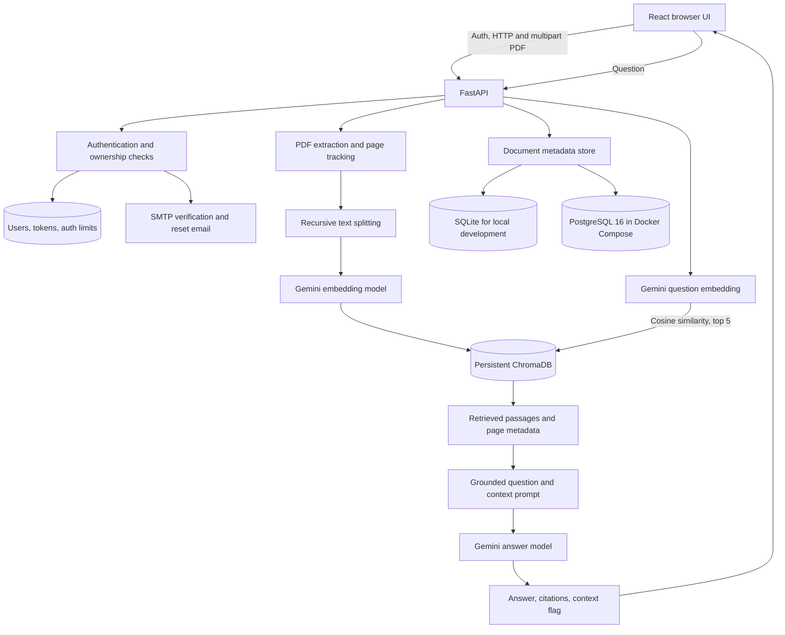

# Architecture and Implementation Notes

## Project purpose

This application lets a user upload a text-based PDF, ask questions about its contents, and receive a Gemini-generated answer grounded in retrieved PDF passages, with document and page citations.

## High-level architecture

ChromaDB stores the vectors, chunk text, and retrieval metadata. The relational database stores users, authentication tokens and rate-limit counters, temporary guest-session metadata, plus document-list metadata such as filename, owner ID, page count, chunk count, size, and creation time. The original PDF is saved under the backend uploads directory.

## Accounts and authorization

- Registration stores a salted scrypt password hash and sends an email-verification link through SMTP. Unverified accounts cannot sign in.
- Login issues a signed, expiring bearer access token. Protected API routes reload the account and check its token version.
- Every document list, count, delete, upload, and query operation is scoped to the current account. Query document IDs are checked for ownership before ChromaDB is queried.
- Password recovery and verification use random, one-time tokens. Only token hashes are persisted; links expire after the configured lifetime. Resetting a password increments the account token version and invalidates prior sessions.
- Auth rate-limit counters are persisted in the relational database for registration, login, verification resend, and password recovery.
- SMTP settings, `AUTH_SECRET_KEY`, token lifetimes, and CORS origins come from environment configuration.

## Temporary guest workspaces

- `POST /api/guest/session` creates an unguessable guest ID and a signed bearer token that expires after `GUEST_SESSION_TTL_HOURS` (24 hours by default). Guest IDs use a separate namespace from account IDs.
- Document list, upload, query, and delete routes accept either an account token or an active guest token. Each document's relational owner ID and ChromaDB document ID filter keep guest workspaces isolated.
- Guest uploads are rate limited and capped at 3 documents, 5 MB, 100 pages, and 1 million extracted characters per PDF by default. Guest queries are limited to 20 per hour, and session creation to 10 per client IP per hour. Limits can be changed through `GUEST_*` settings.
- `DELETE /api/guest/session` removes the current guest's vectors, files, metadata, and session. A background cleanup checks for expired sessions at startup and every 15 minutes; failed cleanup is logged and retried on a later pass.
- Guest workspaces are temporary and not recoverable. The UI warns users not to upload sensitive documents. Use HTTPS for public access.

## PDF ingestion flow

1. The browser sends the PDF as the `file` multipart field to `POST /api/documents/upload`.
2. FastAPI checks the `.pdf` filename and the configured upload-size limit.
3. The API associates the upload with the authenticated account. `pypdf` extracts text page by page. Empty-text pages are skipped, and extracted pages retain their original page numbers. Image-only/scanned PDFs are not OCR-processed.
4. LangChain's `RecursiveCharacterTextSplitter` splits each page independently, using a **1,000-character chunk size** and **150-character overlap**. Each chunk carries document ID, filename, page number, and a unique chunk ID.
5. Gemini embeds the chunks. ChromaDB stores each vector alongside its chunk text and metadata.
6. After vector indexing succeeds, SQLAlchemy writes the document metadata and owner ID to the configured relational database.
7. If processing fails, the uploaded PDF is removed. If metadata persistence fails after indexing, the API attempts to remove the indexed vectors and uploaded PDF as cleanup.

Relevant code:

- PDF extraction, chunking, and upload validation: [backend/app/services/pdf_service.py](./backend/app/services/pdf_service.py)
- Upload API and metadata persistence: [backend/app/main.py](./backend/app/main.py)
- Document metadata schema, database sessions, and legacy JSON import: [backend/app/services/document_store.py](./backend/app/services/document_store.py)

## Question and retrieval flow

1. The authenticated browser posts a question and optional owned document IDs to `POST /api/query`.
2. The query path embeds the question with the configured embedding model.
3. The API checks every requested ID belongs to the authenticated user. ChromaDB searches the persistent `workspace_docs` collection, configured for cosine distance. The default **top-k is 5**; the search is filtered to the user's selected documents (or all of that user's documents).
4. The retrieved passages, filenames, and page numbers are assembled into a prompt that instructs Gemini to answer only from the provided context.
5. The response includes the answer, source passages with document/page citations and similarity scores, and a `has_sufficient_context` flag.
6. If no chunks are found, the API returns a not-enough-information answer without calling the chat model.

Relevant code:

- Embedding setup, ChromaDB writes/searches, prompt construction, and answer generation: [backend/app/services/rag_service.py](./backend/app/services/rag_service.py)
- Chunk, overlap, and top-k defaults: [backend/app/core/config.py](./backend/app/core/config.py)

## Models and version information

The checked-in configuration defaults to:

| Purpose | Provider and model ID |
| --- | --- |
| Answer generation | Google Gemini, `gemini-3.6-flash` |
| Text embeddings | Google Gemini, `models/gemini-embedding-001` |

These are model IDs, not pinned model release dates; the selected model can be overridden with `GEMINI_MODEL` and `GEMINI_EMBEDDING_MODEL`. API access, available models, and quotas depend on the Google AI project and can change independently of this source code.

The backend's direct dependencies are pinned in `backend/requirements.txt`. The frontend has a committed npm lockfile and is installed with `npm ci` in CI and in its production image.

## Persistence and runtime configuration

- Local development defaults to SQLite via `DATABASE_URL=sqlite:///./docs_meta.db`.
- Docker Compose runs PostgreSQL 16 for document metadata and uses named volumes for PostgreSQL, ChromaDB, and uploaded files.
- `GOOGLE_API_KEY`, `GEMINI_MODEL`, and `GEMINI_EMBEDDING_MODEL` configure Gemini. `AUTH_SECRET_KEY`, `FRONTEND_URL`, and `CORS_ORIGINS` configure authentication/browser integration. SMTP configuration controls verification and reset email. Never put a real credential in this document or commit a `.env` file.
- Other settings include `MAX_DOCS` (default 30), `MAX_FILE_SIZE_MB` (default 10), `CHUNK_SIZE` (1,000 characters), `CHUNK_OVERLAP` (150 characters), and `TOP_K` (5). Authentication limits and token lifetimes are configurable through the `AUTH_*` and `*_TOKEN_EXPIRE_MINUTES` environment variables.
- `DocumentStore` can import existing `uploads/docs_meta.json` metadata into the relational database once.

## API surface

| Method | Route | Purpose |
| --- | --- | --- |
| `GET` | `/health` | Check backend and metadata database connectivity |
| `POST` | `/api/auth/register`, `/api/auth/login` | Register or sign in |
| `POST` | `/api/auth/verify-email`, `/api/auth/verify-email/resend` | Verify an address or resend verification |
| `POST` | `/api/auth/password/forgot`, `/api/auth/password/reset` | Start or complete password recovery |
| `GET` | `/api/auth/me` | Return the authenticated account |
| `POST` | `/api/guest/session` | Create a temporary guest workspace |
| `DELETE` | `/api/guest/session` | Delete the current guest workspace |
| `GET` | `/api/documents` | List the authenticated user's or guest's documents |
| `POST` | `/api/documents/upload` | Extract, chunk, embed, and index a PDF for its owner |
| `DELETE` | `/api/documents/{doc_id}` | Remove an owned document's metadata, file, and vectors |
| `POST` | `/api/query` | Retrieve owned-document context and generate a cited answer |

The React UI is in [frontend/src/App.jsx](./frontend/src/App.jsx). Local setup and test commands are in [README.md](./README.md).

## Known limitations and verification

- Scanned/image-only PDFs need OCR, which is not included.
- Gemini embedding quotas can reject uploads. The upload endpoint maps quota exhaustion to HTTP 429; retry after the provider's rate-limit window or review the Google AI project's quota/billing.
- API credentials and provider calls are required for live Gemini tests. SMTP credentials are required to test real account email delivery. Unit/API tests mock these external services.
- GitHub Actions runs the backend unittest suite and frontend production build. Docker/PostgreSQL and real Gemini/SMTP integration still need validation in an environment with Docker and provider credentials.
- Docker/PostgreSQL startup and real Gemini/SMTP integration have not been verified here; validate them in the target deployment environment.
- For accurate client-IP rate limits behind a reverse proxy, trust forwarded IP headers only from that proxy.
